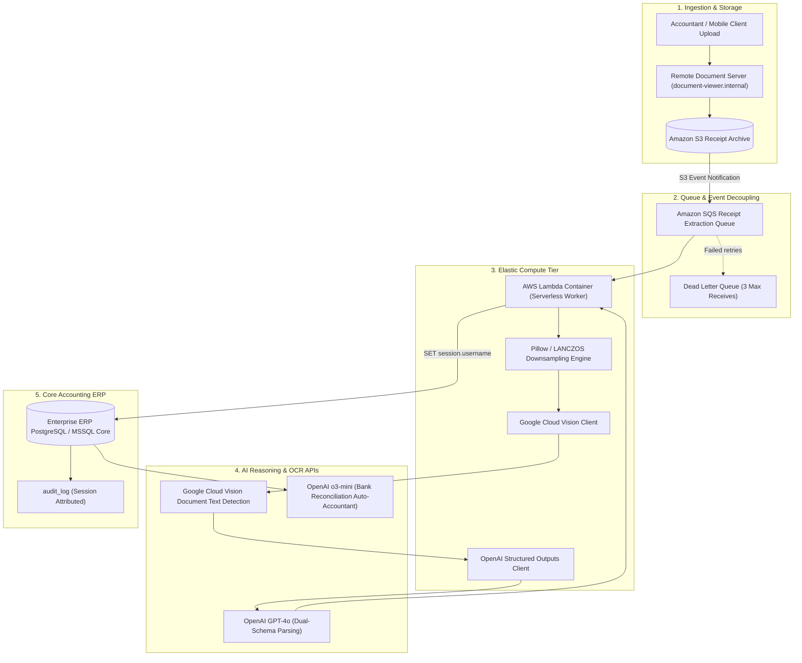

# System Architecture & Processing Lifecycle

[← Main README](../README.md) · [← Documentation Index](README.md)

This document details the event-driven serverless architecture, request lifecycle, memory isolation, and fault recovery mechanisms of the **Enterprise AI Receipt Extraction & Ledger Reconciliation Platform**.

---

## 1. High-Throughput Event-Driven Architecture

The processing pipeline is architected around containerized **AWS Lambda** worker instances backed by **Amazon SQS** to decouple heavy image downsampling and multi-modal LLM reasoning from synchronous HTTP web clients:

---

## 2. Request & Execution Lifecycle

1. **Queue Trigger**: SQS delivers a batch of receipt metadata jobs to containerized Lambda workers.
2. **Decompression Bomb Guard & Memory Isolation**:
   - `Image.MAX_IMAGE_PIXELS = None` is applied with safe memory guards.
   - Images exceeding 74M+ pixels are proportionally downscaled via windowed sinc interpolation (`Image.Resampling.LANCZOS`).
   - Color palettes (`RGBA` / `P`) are flattened to pure 3-channel `RGB` to prevent JPEG encoding faults.
3. **OCR Extraction & Caching**:
   - The optimized payload is submitted to Google Cloud Vision.
   - Text annotations and spatial bounding tokens are cached into `double_entry.receipt_ocrs` to prevent redundant API charges upon subsequent retries.
4. **Parallel Dual-Schema Semantic Extraction**:
   - Using Python `ThreadPoolExecutor(max_workers=2)`, two concurrent requests are dispatched to OpenAI GPT-4o with strict Pydantic schemas:
     - `ReceiptData`: Supplier, date, invoice number, line items, currency, VAT, total amount.
     - `ReconciliationData`: Payment method, card identifier, bank reference, VAT breakdown.
5. **Deterministic Danish VAT Cross-Check**:
   - The system mathematically tests whether the statutory 25% VAT equation holds ($Brutto = Netto \times 1.25$).
   - If inconsistent, a targeted retry or auto-accountant prompt adjusts rounding drift without hallucination.
6. **Session-Scoped Database Mutation**:
   - The worker executes `SET session.username = 'ai-service@accounting.internal'` and commits structured rows into `double_entry.typing_output` and `task_bots.typer_bot_output`.

---

## 3. Fault Tolerance & Deadlock Prevention

- **Null-Byte Sanitization**: Receipt OCR text from degraded mobile scans frequently contains ASCII `\x00` null characters. A recursive sanitizer removes all null bytes before inserting payloads into PostgreSQL JSONB columns.
- **Atomic Queue Retries**: If external LLM APIs experience rate limits (HTTP 429), exponential backoff with jitter pauses the Lambda task; if unrecovered, SQS releases the visibility timeout for another worker to attempt without lost state.

Related: [Domain Map](domain-map.md) · [Computer Vision](computer-vision-pipeline.md) · [AI Parsing](ai-parsing-and-revalidation.md)
