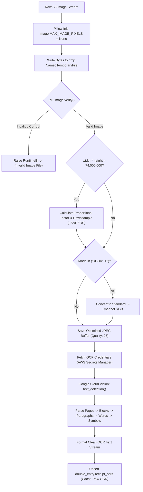

# Computer Vision Pipeline & Ingestion Guardrails

[← Main README](../README.md) · [← Documentation Index](README.md)

## Overview

The computer vision subsystem is the entry barrier for all receipts entering the automated accounting pipeline. Processing scans from diverse hardware—ranging from 12-megapixel smartphone snapshots to uncompressed 1200-DPI flatbed legal scans (>74 million pixels)—demands defensive memory management, dynamic image resampling, and resilient OCR error isolation.



---

## 1. Defending Against Decompression Bombs & Memory Exhaustion

When decoding legal scans or uncompressed TIFF/PNG images, default image processing libraries flag files exceeding 89,478,485 pixels as potential `DecompressionBombError` denial-of-service attempts.

However, Danish legal documents, tax audits, and enterprise payroll summaries frequently exceed standard resolution boundaries. To prevent false-positive pipeline halts:

```python
from PIL import Image

# Disable PIL's pixel cap to permit large high-DPI legal document scans
Image.MAX_IMAGE_PIXELS = None
```

In standard AWS Lambda environments with 512MB–3GB RAM, decompressing an uncompressed 80-megapixel 4-channel RGBA image into an uncompressed memory buffer requires approximately:
$$80{,}000{,}000 \times 4 \text{ bytes} \approx 320 \text{ MB}$$
During image transformation, color quantization, and LANCZOS filtering, intermediate memory peaks can exceed 4–6x the base buffer size. By provisioning the Lambda runtime with **10,240 MB (10 GB)** of memory, the worker ensures sufficient headroom to execute in-memory image transformations without risking an out-of-memory (`OOM`) process termination.

---

## 2. Dynamic 74M-Pixel LANCZOS Downsampling

Google Cloud Vision API imposes a hard limit of approximately 75 million pixels per image payload. Submitting images exceeding this threshold results in an immediate HTTP `400 Bad image data` rejection.

To guarantee zero API rejections while preserving fine-print optical clarity (such as 6pt VAT registration numbers and decimal commas), the preprocessor computes an exact proportional scale factor:

$$\text{Scale Factor} = \sqrt{\frac{74{,}000{,}000}{\text{width} \times \text{height}}}$$

$$\text{New Width} = \lfloor \text{width} \times \text{Scale Factor} \rfloor$$
$$\text{New Height} = \lfloor \text{height} \times \text{Scale Factor} \rfloor$$

### Resampling Filter Comparison

| Resampling Algorithm | Sharpness & Decimal Legibility | Computational Overhead | Artifact Risk | Selection Rationale |
|---|---|---|---|---|
| **Nearest Neighbor** | Extremely Poor (dropped dots/commas) | Minimal (~5ms) | High aliasing | Rejected |
| **Bilinear** | Moderate (slight blurring of fine text) | Low (~35ms) | Soft edges on small fonts | Rejected |
| **Bicubic** | High (acceptable for standard text) | Medium (~95ms) | Minor ringing around letters | Acceptable |
| **LANCZOS (Windowed Sinc)** | **Highest (maximum contrast retention on micro-text)** | High (~180ms) | Negligible ringing | **Production Default** |

```python
if total_pixels > 74_000_000:
    scale_factor = (74_000_000 / total_pixels) ** 0.5
    new_width = int(width * scale_factor)
    new_height = int(height * scale_factor)

    resample_filter = getattr(Image.Resampling, 'LANCZOS', Image.LANCZOS)
    resized_img = img.resize((new_width, new_height), resample_filter)

    if resized_img.mode in ('RGBA', 'P'):
        resized_img = resized_img.convert('RGB')

    resized_img.save(image_path, quality=95)
```

---

## 3. Hierarchical Text Assembly & Normalization

Google Cloud Vision returns OCR text as a structured hierarchy rather than a flat string:
$$\text{Page} \longrightarrow \text{Block} \longrightarrow \text{Paragraph} \longrightarrow \text{Word} \longrightarrow \text{Symbol}$$

Iterating through individual symbols guarantees that spaces, non-standard line breaks, and European currency signs are extracted in correct spatial reading order:

```python
@staticmethod
def format_ocr_response(annotation: vision.TextAnnotation) -> str:
    if not annotation:
        return ""

    extracted_text = ""
    for page in annotation.pages:
        for block in page.blocks:
            for paragraph in block.paragraphs:
                for word in paragraph.words:
                    word_text = "".join([symbol.text for symbol in word.symbols])
                    extracted_text += word_text + " "
                extracted_text += "\n"

    return extracted_text.strip()
```

---

## 4. Optical Orientation Normalization (`degrees`)

Physical receipts photographed using mobile devices often arrive rotated by 90°, 180°, or 270°. Rather than relying on lossy programmatic image rotations before OCR, the platform uses a hybrid approach:
1. Google Cloud Vision and GPT-4o read multi-oriented text natively.
2. The core parser detects the orientation angle and populates the `Degrees` field (`0, 90, 180, 270`).
3. This rotation angle is persisted to `receipts.degrees`.
4. When human auditors inspect receipts in the Win-Man PHP file viewer, the image is rendered with on-the-fly CSS/PHP rotation:
   ```
   http://fileviewer.revisor1.dk/lib/GetFile.php?filename={s3_path}&rotateDegrees={degrees}
   ```
This avoids degrading original S3 image binaries while guaranteeing optimal orientation for human review.

---

## 5. Cost-Optimized OCR Caching & Secrets Management

- **Database-Level OCR Caching**: Google Cloud Vision costs $1.50 per 1,000 units. For re-runs, historical audit reviews, or banking rule backfills (`backfill_reconciliation`), raw OCR text is cached in `double_entry.receipt_ocrs`. Subsequent pipeline passes query PostgreSQL directly, reducing recurring OCR costs to $0.
- **Dynamic Secrets Management**: Zero cloud service account credentials exist within Docker container layers or Git repositories. Credentials for Google Cloud Platform Vision are fetched dynamically via Boto3 from AWS Secrets Manager (`google_cloud_platform_vision`) on worker initialization.

Related: [AI Parsing Deep Dive](ai-parsing-and-revalidation.md) · [Code Examples](code-examples.md) · [ADR 002](decisions/002-dual-engine-ocr-llm-pipeline.md)
