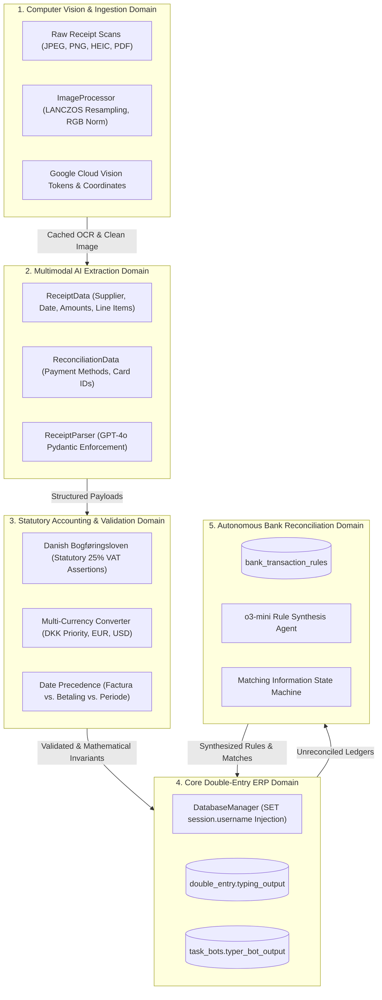

# Domain Map & System Decomposition

[← Main README](../README.md) · [← Documentation Index](README.md)

This document maps the bounded contexts, core data models, and interaction boundaries of the **Enterprise AI Receipt Extraction & Ledger Reconciliation Platform**.

---

## 1. Domain Decomposition Overview

---

## 2. Bounded Context Specifications

### 2.1 Computer Vision & Ingestion Domain
- **Responsibilities**: Ingests multi-format receipts from S3/FileViewer, dynamically computes scaling ratios for ultra-high-resolution files (>74M pixels), converts exotic color spaces to standard RGB, and extracts dense text tokens with spatial coordinates.
- **Key Files**: `image_processor.py`, `receipt_processor.py`.

### 2.2 Multimodal AI Extraction Domain
- **Responsibilities**: Submits OCR text and visual crops in parallel to OpenAI GPT-4o using Pydantic structured output models, eliminating JSON formatting hallucinations and field truncation.
- **Key Files**: `receipt_parser.py`, `pydantic_models.py`.

### 2.3 Statutory Accounting & Validation Domain
- **Responsibilities**: Implements Danish tax law (*Bogføringsloven*). Validates that the total gross matches the net plus 25% Moms. Resolves complex multi-currency exchange receipts and handwritten tips.
- **Key Files**: `ai_revalidation.py`, `retry_incorrect_amounts.py`.

### 2.4 Core Double-Entry ERP Domain
- **Responsibilities**: Injects regulatory user identity (`ai-service@accounting.internal`), sanitizes ASCII null-bytes from strings, executes parameterized queries against core double-entry ERP tables, and updates task processing queues.
- **Key Files**: `database_manager.py`, `sql_models.py`.

### 2.5 Autonomous Bank Reconciliation Domain
- **Responsibilities**: Matches bank statement entries against booked receipt invoices, uses `o3-mini` to synthesize regex pattern rules for recurring merchant charges, and invalidates outdated matching state.
- **Key Files**: `auto_accountant.py`, `type_and_reconcile_receipt_bot.py`.

Related: [Architecture](architecture.md) · [Code Examples](code-examples.md) · [ERP Safety](erp-reconciliation-and-safety.md)
