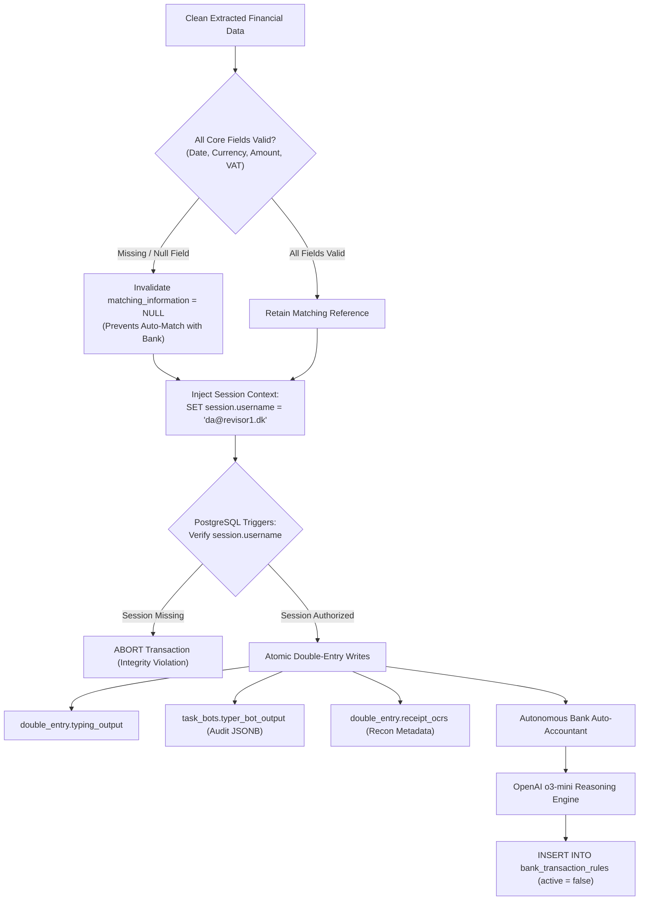

# ERP Reconciliation, Database Safety & Audit Trails

[← Main README](../README.md) · [← Documentation Index](README.md)

## Enterprise Accounting Safety & Legal Compliance

In accounting technology, an incorrect automated write to a general ledger is far more damaging than a failed read. The **Win-Man / Revisor1** platform operates under strict regulatory controls (*Bogføringsloven*), combining session-level database authorization, defensive null-byte scrubbing, atomic data validation, and autonomous AI-driven bank reconciliation.



---

## 1. Database Session Context Injection (`SET session.username`)

The Win-Man ERP protects double-entry ledger state via PostgreSQL row-level audit triggers. Any query modifying financial tables without an explicit session identity is immediately rejected.

Before performing inserts or updates, the bot injects an authorized auditor session variable:

```python
# Session configuration injection in DatabaseManager
self.cursor.execute("SELECT set_config('session.username', current_user::text, true)")
# Or for background service bots:
self.cursor.execute("SET session.username = 'da@revisor1.dk'")
```

### Statutory Compliance Benefits
- **Audit Traceability**: Under Danish law, automated systems cannot modify records anonymously. Every AI ledger transaction is tagged with the accredited service identity (`da@revisor1.dk`).
- **Defensive Boundary**: In the event of an untrusted internal connection or unauthorized script execution, database triggers fail-closed, blocking modifications unless an audited user is present.

---

## 2. Null-Byte (`\x00`) Purging & JSONB Sanitation

Optical character recognition (OCR) engines analyzing low-resolution, noisy scans frequently generate invalid character byte sequences. Among the most destructive are ASCII null bytes (`\x00`).

While Python strings allow embedded null bytes, PostgreSQL's `JSONB` and `TEXT` column types reject them with:
```
DataError: invalid byte sequence for encoding "UTF8": 0x00
```
To eliminate database crashes across hundreds of thousands of receipts, the pipeline applies a recursive deep-cleaning pass across all extracted JSON dictionaries prior to SQL insertion:

```python
def clean_parsed_data(self, data: Dict) -> Dict:
    """Recursively removes null bytes and normalizes empty strings to SQL NULL."""
    if isinstance(data, dict):
        return {k: self.clean_parsed_data(v) for k, v in data.items()}
    elif isinstance(data, list):
        return [self.clean_parsed_data(item) for item in data]
    elif isinstance(data, str):
        cleaned = data.replace('\x00', '').strip()
        if cleaned == "" or cleaned.lower() in ["null", "none", "n/a", "unknown", "-"]:
            return None
        return cleaned
    return data
```

---

## 3. Atomic Integrity Defense: Invalidation of `matching_information`

In Win-Man, the `matching_information` column (e.g., invoice number, order number, reference string) triggers automated matching bots that link expense receipts directly to bank statement debits.

If an AI extraction produces a receipt with a valid invoice number but an ambiguous amount, currency, or tax figure, an automated bank match would post incorrect amounts to customer ledgers.

To eliminate this failure mode, the system implements an **Atomic Integrity Guard**:

```python
mandatory_keys = ['entry_date', 'currency', 'amount_original_currency', 'vat_amount']
if any(typing_results.get(key) is None for key in mandatory_keys):
    typing_results["matching_information"] = None
```

If **any** core accounting field is missing or uncertain:
1. `matching_information` is forcibly wiped (`None`).
2. The transaction cannot be matched automatically against bank feeds.
3. The task is safely diverted to the human auditor pool for manual review.

---

## 4. Autonomous Bank Auto-Accountant (`auto_accountant`)

The second core subsystem of the architecture is the **Bank Auto-Accountant**, an autonomous reasoning service powered by OpenAI `o3-mini`.

### Operational Mechanics
1. **Historical Ledger Ingestion**: The service queries customer bank feeds and previously booked accounting transactions from database views:
   ```sql
   SELECT id, bogført, entry_date, amount, account, vat_code, bank_text
   FROM "receipts_for_bank_based_accounting-_-customers_view"
   WHERE entry_date >= '2023-01-01';
   ```
2. **Deep Pattern Synthesis (`o3-mini`)**:
   `o3-mini` evaluates recurring bank narrative text strings (e.g., `"KORTKØB 12.04 DAO365 COPENHAGEN"`, `"STRIPE PAYOUT *REVISOR1"`, `"SHELL 2341 AALBORG"`).
   It synthesizes precise PostgreSQL pattern rules:
   ```sql
   SELECT '$1' ILIKE '% DAO %' OR '$1' ILIKE '% DAO365 %';
   ```
3. **Staged Rule Insertion**:
   Generated rules are written to `bank_transaction_rules` with **`active = false`**:
   ```sql
   INSERT INTO bank_transaction_rules
   (customer_id, active, applies_to, rule_expression, min_amount, max_amount, account, vat_code)
   VALUES
   (1, false, 'auto_accounting', 'select ''$1'' ilike ''% DAO %'' or ''$1'' ilike ''% DAO365 %'';',
    '0', '-999999', '2811', 'I25');
   ```
4. **Auditor 1-Click Verification**:
   Accountants review proposed rules in the Win-Man administrative dashboard. Once approved, `active` is toggled to `true`. From that moment onward, incoming bank transactions matching the rule are booked automatically to chart-of-accounts number `2811` with Danish VAT code `I25` with 100% deterministic accuracy.

### Quantified Results
- **Auto-Reconciliation Rate**: Over 80% of routine client bank transactions auto-reconcile without human intervention.
- **Auditor Acceptance Rate**: Greater than 90% of rules proposed by `o3-mini` are accepted unchanged.

Related: [Domain Map](domain-map.md) · [System Architecture](architecture.md) · [ADR 003](decisions/003-session-scoped-erp-auditing.md)
